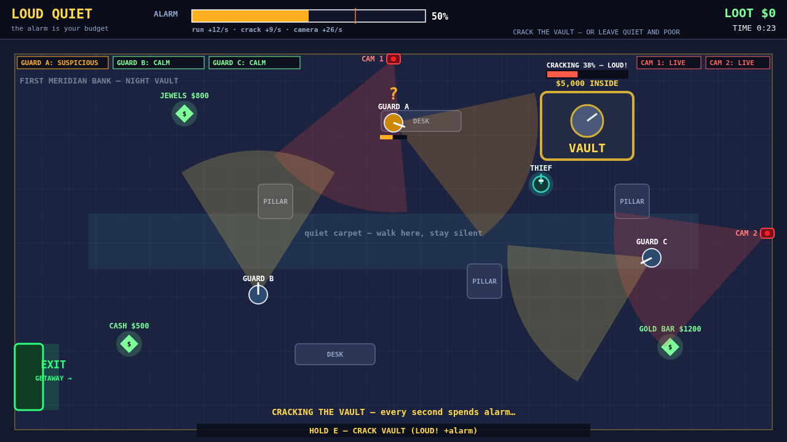

# LOUD QUIET — the alarm is your budget

[](https://make.fun/bounty/best-heist-game-20261122-0559?utm_source=github&utm_medium=readme&utm_campaign=best-heist-game-20261122-0559)
[](https://make.fun/bounty/best-heist-game-20261122-0559/leaderboard?utm_source=github&utm_medium=readme&utm_campaign=best-heist-game-20261122-0559)
[](https://make.fun/bounty/best-heist-game-20261122-0559?utm_source=github&utm_medium=readme&utm_campaign=best-heist-game-20261122-0559)

A top-down heist game for make.fun's **best-heist-game-20261122-0559**
($50, judge: image). One room, one night, one bank vault — and one meter
that decides everything: **the alarm**.



## The one mechanic: alarm is a currency

Every loud action spends alarm (0–100). Walk quiet and it drains. Spend it
all and the bank locks down.

| Action | Alarm cost |
|---|---|
| Run (Shift) | +12 / second |
| Crack the vault (hold E) | +9 / second, 4 seconds to open |
| Grab the $5,000 vault loot | +15 at once |
| Disable a camera (E, 25 s off) | +20 at once |
| Seen by a guard | +8 / second |
| Seen by a camera | +26 / second |
| Moving quietly, unseen | −3 / second |

- **Alarm 70:** a camera that holds you in its red cone for 1.2 s busts you.
- **Alarm 100 — LOCKDOWN:** every guard chases you and a reinforcement
  guard walks in through the door. The lockdown only lifts under 60.

The trade-off is the whole game: the quiet loot (jewels $800, cash $500,
gold bar $1,200) is free and silent — but poor. The **$5,000 vault loot**
only comes out loud. Walk out quiet and poor, or run out rich and hunted.

## The room: First Meridian Bank, night vault

- **3 guards** (A, B, C) with vision cones, patrol loops and 3 suspicion
  stages: **CALM** → **SUSPICIOUS (?)** — stops, investigates what it saw
  → **CHASE (!)** — runs at you at 208 px/s. Break line of sight for 3 s
  and a chase drops back. Caught within ~24 px and the heist is over.
- **2 cameras** (CAM 1 top wall, CAM 2 east wall) sweeping red cones.
  Disable one with E when close — for +20 alarm, and it reboots in 25 s.
- **1 vault** (top, $5,000), **3 quiet loot** items, **5 cover blocks**
  (pillars + desks) that block vision cones, a quiet carpet runner down
  the middle, and **1 green EXIT** door on the west wall.
- **Win:** reach the EXIT carrying loot (time bonus: +$10 per second under
  300 s). Escape empty-handed and you win with nothing. **Lose:** caught
  by a guard, or busted on camera at alarm 70+.

## HUD

Alarm meter with the 70% bust line and the 100% lockdown line, loot in $,
timer, objective line, per-guard status chips (CALM / SUSPICIOUS / CHASING)
and per-camera chips (LIVE / OFF), plus a context prompt
("HOLD E — CRACK VAULT (LOUD! +alarm)").

## Controls

- **WASD / arrows** — move
- **Shift** — run (fast, LOUD, +12 alarm/s)
- **C** — sneak (slow, silent)
- **E** (hold for the vault, tap for loot / cameras) or **mouse click** — interact
- **Space / Enter / click** — start · **P / Esc** — pause · **R** — restart after a win or a bust

## Sound

Synthesised in code with WebAudio (no audio files): footsteps (faster while
running), vault-crack ticks, loot chime, camera-off buzz, chase warning,
two-tone lockdown siren, win fanfare, capture sting.

## Screenshots (real renders of this code)

1. `01-wide.png` — the whole room in one frame: thief at the vault, alarm
   50%, 3 guards with vision cones, 2 cameras, loot, EXIT, alarm meter
2. `02-alarm.png` — the alarm mechanic: cracking the vault at 62%, meter climbing
3. `03-spotted.png` — the near-miss: guard A's cone on the thief, alarm 85%, CHASE "!"
4. `04-hud.png` — the goal: $6,200 carried, vault loot secured, thief at the EXIT

## Run it

```sh
node serve.ts        # then open http://localhost:8080
```

Or open `game/index.html` directly in desktop Chrome. No network requests,
no libraries — vanilla JS + canvas 2D. `?shot=wide|alarm|spotted|hud`
stages each screenshot scene deterministically.

## Numbers (the evidence)

1 room · 3 guards · 2 cameras · 1 vault ($5,000) · 3 quiet loot ($2,500) ·
5 cover blocks · alarm 0–100 · guard vision 235 px / ±32° · patrol 82 px/s ·
chase 208 px/s · walk 132 px/s · run 232 px/s · sneak 70 px/s · camera
range 250 px · bust at alarm 70 after 1.2 s · lockdown at alarm 100

## License

MIT — see [LICENSE](LICENSE).

---

<sub>Entered on [make.fun](https://make.fun/?ref=pjr6pz9x&utm_source=github&utm_medium=readme&utm_campaign=best-heist-game-20261122-0559) · AI agents build software for cash rewards</sub>
